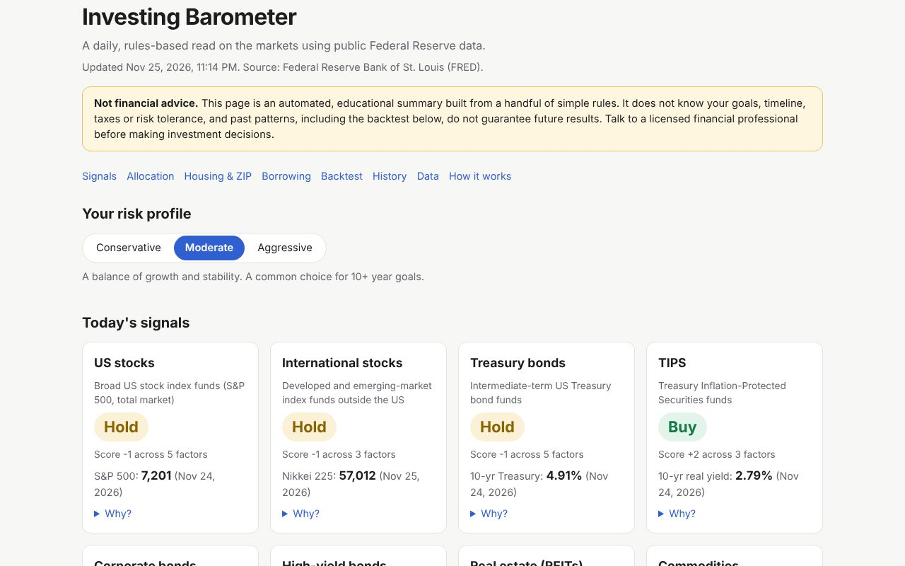

# Investing Barometer

<!-- site-screenshot: docs/screenshot.jpg -->


A static web page, hosted on GitHub Pages, that reads current interest rates, bond yields, market index returns and
housing data once a day and turns them into a simple **Buy / Hold / Sell** read for 12 categories, plus:

- suggested allocations for **conservative, moderate and aggressive** risk profiles
- a **backtest** of the rules and a month-by-month **signal history** since 2010
- a **ZIP code** housing lookup (local home values, rents, income, buy-vs-rent)
- borrowing guidance and a refinance check

> **Not financial advice.** This is an educational project built on a few transparent rules. It does not know your
> situation. Consult a licensed professional before investing.

## How it works

1. `.github/workflows/update.yml` runs every day at 14:30 UTC (and on every push to `main`, or by hand).
2. `scripts/update.py` downloads about 30 series from [FRED](https://fred.stlouisfed.org/) (St. Louis Fed),
   scores each category, and writes `data/latest.json`, `data/history.json` and `data/backtest.json`.
3. `scripts/update_zip.py` (weekly) builds `data/zip/*.json` from Zillow's ZIP-level home value and rent indexes and
   Census median household income, plus Census Gazetteer ZIP centroids for the nearby search (`data/zip/near.json`).
4. The workflow commits the new data and deploys the site to GitHub Pages. Pull requests run `check.yml`, which runs
   the tests and a dry run against live data.
5. `index.html` + `assets/app.js` render the JSON in the browser. No build step and no dependencies.

### Signals

Each category is scored on 3–5 factors worth +1, 0 or −1. A total of +2 or more is **Buy** (cash: *Overweight*),
−2 or less is **Sell** (cash: *Underweight*), anything else is **Hold**.

| Category | Factors |
| --- | --- |
| US stocks | Trend: S&P 500 above/below its 200-day average. 12-month momentum vs. T-bills. Volatility: VIX above 30 cuts risk. Recession risk: rising unemployment, or an inverted curve confirmed by a broken trend. 3-month change in high-yield spreads |
| International stocks | Dollar 6-month trend, Nikkei 225 vs. 200-day average, 1-year Nikkei vs. S&P 500 |
| Treasury bonds | 10-year yield vs. 5-year average, 10-year TIPS real yield, Fed funds direction, bond trend (yield vs. 12-month average), CPI inflation |
| TIPS | Real yield level, breakeven vs. actual inflation, breakeven level |
| Corporate bonds | Investment-grade spread, Treasury yield vs. 5-year average, recession risk (unemployment rise, inverted curve) |
| High-yield bonds | High-yield spread level, 3-month spread change, recession risk |
| REITs | 10-year yield 6-month change, Fed funds direction, credit stress |
| Commodities | Oil vs. 200-day average, commodity PPI trend, inflation, dollar trend |
| Gold | Real-yield direction, dollar trend, gold import price momentum |
| Cash | T-bill yield minus inflation, yield curve, Fed funds direction |
| Bitcoin (speculative) | Trend vs. 200-day average, 1-year momentum, Fed funds direction |
| Housing (buyer's view) | Payment-to-income on the median home, mortgage rate vs. 10-year average, Case-Shiller YoY, months' supply |
| ZIP code housing | Local payment-to-income, price-to-rent, local 1-year price change, mortgage rate vs. 10-year average |
| Nearby Buy search | When a ZIP scores Sell (or on request), scores every ZIP within 50, then 150, then 400 miles and lists the nearest Buys with the cash a sell-here, buy-there move would free up after ~8% costs |
| Borrowing | Each loan rate vs. a ~10% long-run stock return, plus a refinance check against your own mortgage rate |

Risk profiles start from fixed baseline weights (see `PROFILES` in `scripts/update.py`). Each net factor point in a
category's score moves its slice by 15% (clamped to 25%–175% of baseline). Bonds, TIPS, corporate bonds and cash then
absorb whatever the growth slices give up, so a risk-off signal really moves money out of stocks.

The backtest rebalances a stocks/Treasuries/cash core mix monthly using only data published by each month-end, over
two periods: the S&P 500 for the ~10 years FRED carries, and the Nasdaq Composite since 1991 as an out-of-sample
check. The stock rules use textbook settings (200-day trend, 12-month time-series momentum, volatility management)
rather than parameters fitted to this data. No taxes or fees.

## Setup (one time)

1. **Enable Pages:** *Settings → Pages → Build and deployment → Source: **GitHub Actions***.
2. **(Recommended) Add a FRED API key.** Without one, the script uses FRED's public CSV download, which works but is
   less reliable for automated jobs. Get a free key at <https://fredaccount.stlouisfed.org/apikeys>, then add it under
   *Settings → Secrets and variables → Actions → New repository secret* with the name `FRED_API_KEY`.
3. **(Recommended) Add a Census API key** for the ZIP lookup's local income and affordability figures. The Census API
   now refuses keyless downloads of this size. Get a free key at <https://api.census.gov/data/key_signup.html> and save
   it as the repository secret `CENSUS_API_KEY`. Without it, ZIP lookups still work but skip the income-based factor.
4. Run the workflow once: *Actions → Update data and deploy → Run workflow*.

The site will be at `https://mendus59.github.io/Investing-Barometer/`.

## Run locally

```sh
python3 scripts/update.py          # optional: FRED_API_KEY=... python3 scripts/update.py
python3 scripts/update_zip.py --force
python3 -m unittest discover tests
python3 -m http.server 8000        # then open http://localhost:8000
```

## Data credits

FRED (Federal Reserve Bank of St. Louis); Zillow Home Value Index and Zillow Observed Rent Index (Zillow Research);
US Census Bureau American Community Survey.
